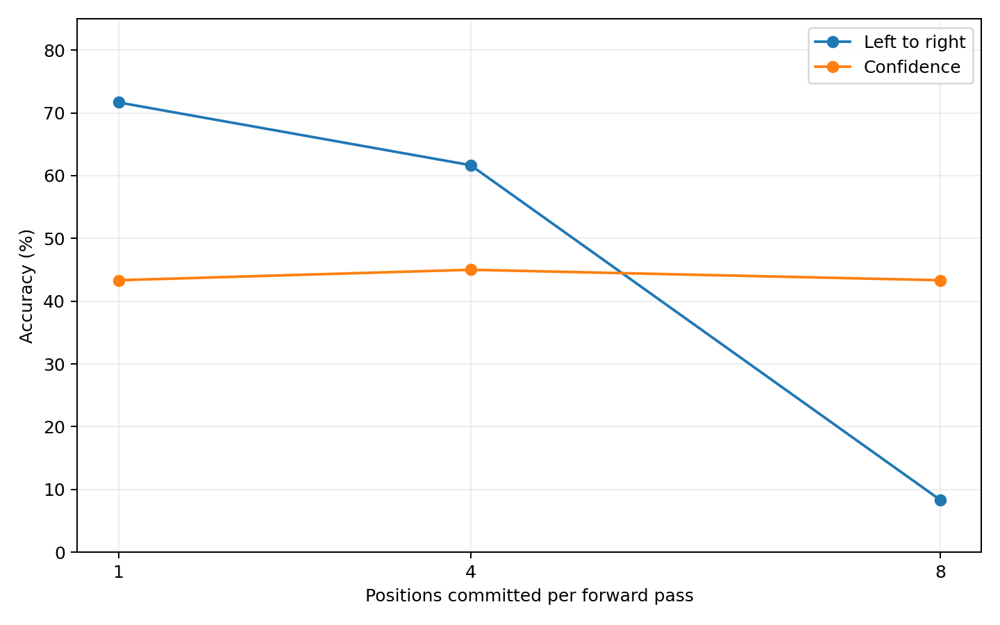
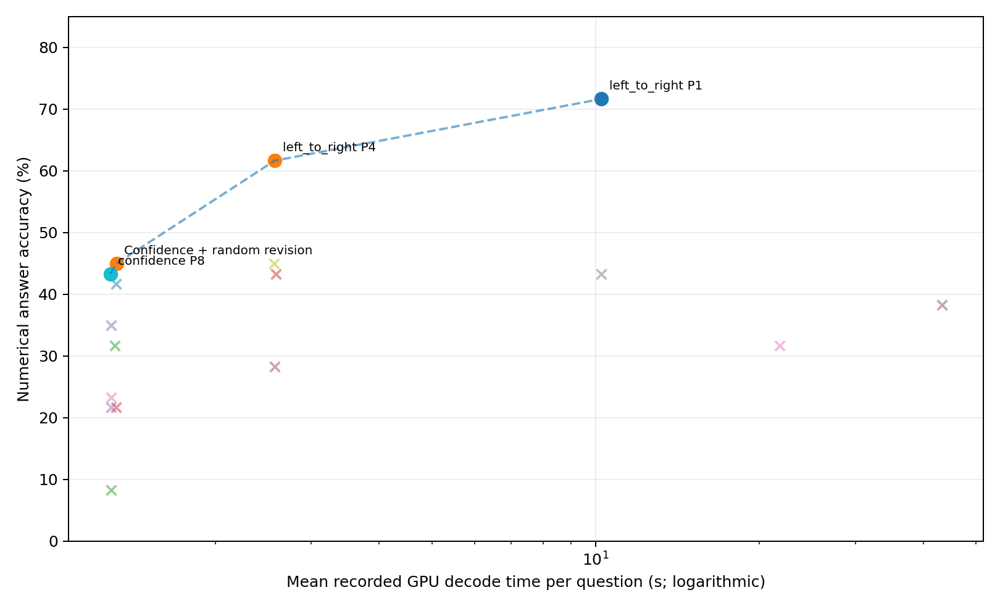

# Unmasking Dynamics in Diffusion Language Models

How do token-selection policy, decoding parallelism, reveal schedule, and online
token revision affect a masked diffusion language model? This project studies
accuracy, decode latency, and output degeneration in **LLaDA-8B-Instruct** on GSM8K.
It is an exploratory research benchmark, with reproducible samplers, CPU tests,
paired analyses, and an explicit record of limitations.

[LLaDA report](reports/phase7/PHASE7_REPORT.md) ·
[Phase 8 AR comparison](reports/phase8/PHASE8_REPORT.md) ·
[Reproduction guide](docs/REPRODUCIBILITY.md) ·
[Repository map](docs/PROJECT_MAP.md) ·
[Privacy and validation audit](docs/AUDIT.md)

## Key findings

On **60 identical GSM8K test questions**, numerical-answer accuracy was:

| Policy | P1 | P4 | P8 |
| --- | ---: | ---: | ---: |
| Left-to-right | **71.7% (43/60)** | **61.7% (37/60)** | 8.3% (5/60) |
| Confidence | 43.3% (26/60) | 45.0% (27/60) | **43.3% (26/60)** |

**P1, P4, and P8 are the numbers of newly committed tokens per decoding step.**
Generation length is fixed at 256 positions: these settings require 256, 64, and
32 decoding steps respectively. Influence-based selection adds counterfactual
forward passes; other evaluated policies use one forward per step.

- **Policy crossover:** LTR leads at P1 and P4; confidence leads at P8 on this sample.
- **Contiguous LTR P8 degeneration:** accuracy falls sharply, alongside increased
  word repetition and fewer final-answer markers. This is not solely an extraction issue.
- **Spaced unmasking partly recovers LTR P8:** 13/60 correct versus 5/60. Spacing also
  changes reveal timing, so the comparison does not isolate adjacent-token interference.
- **Remasking gains depend on the starting policy:** low-confidence revision of
  spaced LTR reaches 19/60, while confidence P8 revision reaches 27/60 (random) or
  25/60 (low-confidence) versus 26/60. These small-sample gains remain statistically uncertain.
- **Accuracy–latency trade-off:** recorded mean GPU decode intervals are about
  1.284 s for confidence P8, 2.573 s for LTR P4, and 10.251 s for LTR P1.
  Cross-job timing is descriptive; forward-pass reduction is not a measured speedup.

These are observations, not proof of a dependency mechanism or general superiority.
See the report for matched discordances, uncertainty, and competing explanations.
Current confidence intervals use a new deterministic, within-stratum paired
bootstrap (10,000 resamples, PCG64 seed 42); [the interval table](reports/phase7/paired_reanalysis.csv)
and [provenance](reports/phase7/bootstrap_provenance.json) are included. Historical
intervals are preserved separately because their original generator is unavailable.





## Experimental setup

| Component | Setting |
| --- | --- |
| Model | `GSAI-ML/LLaDA-8B-Instruct` |
| Model/tokenizer revision | `852152c60bdfed4632635bfcf3e83408ad3f65bf` |
| Dataset | `openai/gsm8k`, `main`, `test` |
| Dataset revision | `740312add88f781978c0658806c59bc2815b9866` |
| Matched benchmark | 60 questions; 20 each with 0–2, 3–4, or 5+ gold `<<...>>` calculations; excludes 150 Phase 1 IDs |
| Selection / inference seeds | `20261014` / `42`; position RNG `42 + question_id`; revision RNG `314159 + question_id` |
| Decoding | BF16; one 256-position block; argmax; MASK suppressed; no early EOS stopping |
| Prompt | Pinned tokenizer chat template; question plus the fixed suffix in phase configs |
| Recorded GPU | NVIDIA RTX PRO 6000 Blackwell Server Edition |
| Primary metric | Exact rational comparison of extracted numerical answer; decode prefix before first EOS |

The extractor prioritizes the last `####` marker, then boxed/answer phrases, then
a logged last-number fallback. Missing extraction counts as incorrect. A correct
number does not establish faithful mathematical reasoning. Calculation counts are
complexity **proxies**, not validated reasoning depth.

Phases 2–6 contain **17 configurations × 60 questions = 1,020 generations**.
Phase 1 uses a different 150-question sample and is excluded from matched comparisons.

## Quick start: CPU verification and public-data analysis

From the repository root, use a Python 3.11 environment (local CPU checks also ran
on Python 3.9). Install a suitable **CPU** PyTorch build separately:

```bash
python -m venv .venv
source .venv/bin/activate
python -m pip install torch==2.7.1
python -m pip install -r requirements-analysis.txt
python -m pip install --upgrade pip setuptools wheel
python -m pip install --no-deps --no-build-isolation -e .
OMP_NUM_THREADS=1 python scripts/check_cpu.py
python -m dllm_unmasking.analyze_phase7 --output-dir results/phase7_reproduced
```

The CPU command runs fixture tests and explicitly skips artifact-dependent tests;
[the guide](docs/REPRODUCIBILITY.md#cpu-tests) explains how to run the entire suite
with private baseline files. The Phase 7 command validates the included 1,020-row
table and regenerates summaries, paired statistics, and three figures in a new
directory. It needs neither weights nor raw model responses and leaves published
figures and historical outputs unchanged.

## GPU reproduction

Full inference requires a supported CUDA GPU, separately obtained pinned weights,
the pinned dataset cache, and the selection manifest. Historical PBS scripts assume
a site module and Conda environment; their allocation codes are public placeholders.
Install [requirements.txt](requirements.txt) in the GPU environment after selecting
a compatible CUDA PyTorch build. Loading the pinned model uses `trust_remote_code=True`;
review its implementation before obtaining weights. Model files are not bundled.

With the existing pinned caches, exact selection, and completed Phase 2 baseline
available at the configured paths:

```bash
export HF_HOME="$SCRATCH_DIR/huggingface"
export HF_HUB_OFFLINE=1 HF_DATASETS_OFFLINE=1 TRANSFORMERS_OFFLINE=1
python -m experiments.phase6.run --check-cache
# Within a PBS GPU allocation; this command performs inference:
python -m experiments.phase6.run --policy left_to_right
```

This is an example of the runner interface, not a command that works from an empty
clone. Follow the [input reconstruction, cache, and PBS instructions](docs/REPRODUCIBILITY.md)
first. No downloads or job submissions are performed by the CPU quick start.

## Project navigation

| Area | Entry points |
| --- | --- |
| Canonical results | [Phase 7 report](reports/phase7/PHASE7_REPORT.md), [per-question data](reports/phase7/unified_per_question.csv), [regeneration](src/dllm_unmasking/analyze_phase7.py) |
| Phase 1 / 1.5 | [Historical methodology](docs/PHASE1.md), [offline report](research/phase15/report.md), [sampler](src/dllm_unmasking/samplers.py) |
| Phase 2 / 2.5 | [Parallel benchmark](experiments/phase2/README.md), [diagnosis](src/dllm_unmasking/analyze_phase25.py), [manual audit](src/dllm_unmasking/prepare_ltr_audit.py) |
| Phase 3 | [Spaced schedule](experiments/phase3/README.md), [schedule definition](src/dllm_unmasking/phase3_schedule.py) |
| Phases 4 / 5 | [Spaced revision](experiments/phase4/README.md), [confidence revision](experiments/phase5/README.md) |
| Phase 6 | [Matched sequential benchmark](experiments/phase6/README.md), [runner](experiments/phase6/run.py), [analysis](src/dllm_unmasking/analyze_phase6.py) |
| Phase 8 | [Completed Qwen baseline and budget sensitivity](reports/phase8/PHASE8_REPORT.md); [generation guide](experiments/phase8/README.md), [runner](experiments/phase8/run.py); Llama remains optional and unevaluated |
| Evaluation / tests | [Unchanged extractor](src/dllm_unmasking/evaluation.py), [test guide](docs/REPRODUCIBILITY.md#cpu-tests), [dependency map](docs/PROJECT_MAP.md) |

Scientific modules live in `src/dllm_unmasking/`; phase runners and PBS templates
live in `experiments/`, with settings in `configs/` and CPU tests in `tests/`.
[The layout guide](docs/STRUCTURE.md) maps every moved file and explains historical
source-hash compatibility. `reports/` and `research/` hold curated public results; `outputs/` and
`results/` hold ignored generated artifacts. Raw responses, trajectories, weights,
environment logs, and credentials are excluded from Git.

## Limitations

This is one model, one task family, a fixed 256-token budget, and a repeatedly
inspected 60-question sample. Strategy development and subgroup analyses are
exploratory. Numerical extraction can reject readable answers or accept invalid
reasoning. Cross-phase GPU stream intervals include host launch gaps and do not
measure production throughput, queue wait, or pure kernel time. The observed
Pareto frontier and small remasking gains need held-out confirmation. No
state-of-the-art or broadly generalizable decoding improvement is claimed.

## Phase 8: completed autoregressive comparison

On the same 60 questions, Qwen2.5-7B-Instruct achieved **28/60 (46.7%)** with a
256-token cap and **50/60 (83.3%)** with a 512-token cap. Mean recorded GPU
**prefill + decode** intervals were **5.324 s** and **6.235 s**, with **32/60**
and **0/60** length-limited outputs. The larger budget yielded 23 recoveries and
one regression; numerical correctness does not establish faithful reasoning.

The 256 comparison matches nominal generated positions, not compute, tokenization,
actual length, or architecture. LLaDA LTR P4/P1 achieved 37/60 and 43/60, with
**decode-only** intervals of 2.573 s and 10.251 s. Cross-model dominance remains
unvalidated until timing boundaries are harmonized; the paired Qwen-512 versus
LTR P1 accuracy difference is statistically uncertain.

See the [canonical Phase 8 report](reports/phase8/PHASE8_REPORT.md) for paired
statistics, strata, output diagnostics, figures and reproducibility, and the
[512 deployment guide](experiments/phase8/QWEN_512.md) for the isolated run setup.
Public-only statistical verification: `python -m dllm_unmasking.finalize_phase8 --verify-public`.
No Phase 9 experiment has been started.
