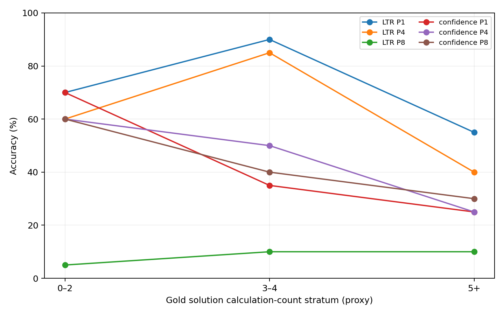

# Diffusion LLM Unmasking Dynamics: Unified Benchmark and Technical Report

**Status:** Exploratory, single-model matched-question benchmark  
**Date:** 15 October 2026  
**Model:** `GSAI-ML/LLaDA-8B-Instruct` (revision `852152c60bdfed4632635bfcf3e83408ad3f65bf`)  
**Task:** GSM8K numerical-answer extraction, 60 stratified test questions reused across Phases 2–6  
**Decoding:** 256 generated positions in one block; bf16; Blackwell RTX PRO 6000; fixed prompts and evaluation framework.

## Executive summary

We evaluated **17 decoding configurations × 60 identical questions = 1,020 generations**. Two striking patterns emerged: (1) left-to-right (LTR) decoding excels when positions are revealed sequentially or in batches of four, but collapses when eight *contiguous* positions are revealed per step; (2) confidence-based selection is comparatively stable across parallelism 1, 4 and 8. Confidence-guided revision can reduce repetitions in a fragile spaced-LTR decoder, but neither random nor low-confidence revision provides a convincing accuracy gain on top of confidence P8.

**Recommended current stopping point:** No further exploratory remasking on these 60 examples. Treat this as a completed within-model *pilot benchmark*, publish reproducible code and transparent findings, then optionally run a held-out confirmation set before asserting generalization or publishing as a research paper.

## Research questions

1. How does increasing the number of newly committed positions per model forward pass affect accuracy for different token-selection policies?
2. Can intra-decoding token revision improve accuracy or generation stability without adding forward passes?
3. Which configurations provide nondominated *observed* accuracy–latency trade-offs on this benchmark?

## Design and data integrity

The Phase 2 question selection is stratified into 20 examples each by the number of annotated gold-solution calculations (`0–2`, `3–4`, `5+`). This number is **a proxy, not an independently validated reasoning-difficulty measure**. Phase 2 generated 600 outputs across five policies × P4/P8, Phase 3 generated 60 spaced-LTR P8 outputs, Phase 4 generated 120 spaced-LTR-plus-revision outputs, Phase 5 generated 120 confidence-plus-revision outputs, and Phase 6 generated 120 P1 outputs. All methods have 60 unique, matching question IDs; observed per-case forward counts are constant within configurations. Older Phase 1 results on a *different* sample are excluded from matched accuracy comparisons.

The journal/manifests record pinned model and dataset revisions, seeds, methods, and the exact decoding configurations. This audit verifies **output-level** completeness and matching, not every internal CUDA operation or hidden implementation detail. Revision uses at most one update per position, choosing up to two previously committed positions per step after the first (62 revision attempts per evaluation). These replace tokens within the normal 32-pass P8 schedule, not with extra model passes.

## Main matched accuracy table

| Policy | P1: 256 passes | P4: 64 passes | P8: 32 passes |
|---|---:|---:|---:|
| Left-to-right | **43/60 = 71.7%** | **37/60 = 61.7%** | 5/60 = 8.3% |
| Confidence | 26/60 = 43.3% | 27/60 = 45.0% | **26/60 = 43.3%** |
| Random | Not evaluated on these 60 | 26/60 = 43.3% | 21/60 = 35.0% |
| Right-to-left | Not evaluated on these 60 | 17/60 = 28.3% | 14/60 = 23.3% |
| Batched influence | Not evaluated on these 60 | 23/60 = 38.3% | 19/60 = 31.7% |

Additional matched P8 runs:

| P8 schedule and revision | Correct / 60 | Accuracy | Mean recorded GPU decode time / question |
|---|---:|---:|---:|
| LTR spaced, no revision | 13 | 21.7% | 1.288 s |
| LTR spaced + random revision | 13 | 21.7% | 1.314 s |
| LTR spaced + low-confidence revision | 19 | 31.7% | 1.309 s |
| Confidence, no revision | 26 | 43.3% | 1.284 s |
| Confidence + random revision | 27 | 45.0% | 1.318 s |
| Confidence + low-confidence revision | 25 | 41.7% | 1.314 s |

### Matched comparisons

Paired comparisons use the **same 60 questions** and exact two-sided McNemar tests. The table below is exploratory; tests across many pairs should not be treated as independent confirmatory claims. Complete bootstrap and p-value outputs appear in `selected_paired_tests.csv`.

| Comparison | Accuracy change (second minus first) | Newly correct / newly incorrect | McNemar exact p |
|---|---:|---:|---:|
| LTR P1 → confidence P1 | −28.3 pp | 3 / 20 | 0.000488 |
| LTR P4 → confidence P4 | −16.7 pp | 8 / 18 | 0.0755 |
| LTR P8 → confidence P8 | +35.0 pp | 22 / 1 | 0.00000572 |
| LTR P4 → LTR P8 | −53.3 pp | 1 / 33 | 0.00000000407 |
| Confidence P1 → confidence P8 | 0.0 pp | 7 / 7 | 1.00 |
| LTR contiguous P8 → LTR spaced P8 | +13.3 pp | 11 / 3 | 0.0574 |
| LTR spaced P8 → + low-conf revision | +10.0 pp | 11 / 5 | 0.2101 |
| Confidence P8 → + random revision | +1.7 pp | 6 / 5 | 1.00 |
| Confidence P8 → + low-conf revision | −1.7 pp | 7 / 8 | 1.00 |

The P1-versus-P8 **relative-policy crossover** is pronounced on the observed sample. At P1 LTR wins (71.7% vs 43.3%); at P8 confidence wins (43.3% vs 8.3%). This does not establish an exact crossover threshold between P4 and P8, nor universal behavior beyond this model and question set.

## Observed accuracy–latency frontier

Using **mean recorded `gpu_seconds` for decoding** (excluding loading and HPC queue wait), the nondominated empirical configurations among the 17 evaluated are:

| Configuration | Correct / 60 | Mean recorded GPU decode time/question | Initial forward passes/question |
|---|---:|---:|---:|
| Confidence P8 | 26 | 1.284 s | 32 |
| Confidence P8 + random revision | 27 | 1.318 s | 32 |
| LTR P4 | 37 | 2.573 s | 64 |
| LTR P1 | 43 | 10.251 s | 256 |

This is **an observed-sample frontier, not a robust statistically established frontier**. In particular, the 27/60 confidence-random-revision point differs from its 26/60 baseline by one question (paired p = 1). Small timing gaps (e.g. 1.284 vs 1.318 s) can be sensitive to run conditions and timer semantics. Paired accuracy uncertainty can change nondomination. For an operational recommendation, **confidence P8, LTR P4, and LTR P1** are the three clearest qualitatively distinct trade-off options; revision has not shown a compelling additional benefit over confidence P8.

The batched-influence implementation was particularly expensive: roughly 21.8–43.2 s/question for P8/P4 respectively, with 536 or 1064 passes/question (including selection overhead). These are implementation-specific costs, not proof that all influence-based decoding is inefficient.

**Timing caveat:** GPU stream timings and host wall timings were separately exposed in Phase 6. The cross-phase chart uses similarly labeled recorded `gpu_seconds`, but was assembled from jobs executed at different times; it is not a controlled latency microbenchmark. Forward pass count is an algorithmic budget proxy, not an exact measure of energy, throughput, or total deployment latency. Confidence-based revision also incurs CPU selection and bookkeeping.

## Generation degeneration and mechanism hypotheses

Contiguous LTR P8 shows severe degeneration: mean longest repeated-word run **27.22**, final-answer marker present in **19/60**, and parser fallback in **39/60**. LTR P1 has mean longest run **1.30**, markers in **55/60**, and fallback in **4/60**. LTR P4 is intermediate (mean longest run **2.75**, markers in **51/60**). The collapse is therefore more than an answer extraction artifact; outputs themselves frequently degrade.

Spacing eight predictions across nonadjacent positions increases LTR P8 accuracy from 5/60 to 13/60, and reduces repetition, but also changes individual positions' reveal times. It does **not cleanly isolate adjacency**. Low-confidence revision of spaced LTR increases accuracy to 19/60 and reduces average longest repeated-word run to **3.92**. Random revision stays at 13/60 and mean longest run **12.08**. Revision attempts: 3,720 per strategy; token changes: **1,149 (30.9%)** under low-confidence targeting, versus **410 (11.0%)** random. These facts establish revisability, not correctness of individual revised tokens.

On confidence P8, random revision reaches 27/60 and low-confidence revision 25/60 versus 26/60 baseline. The absence of a consistent accuracy gain is compatible with a decoder that already chooses relatively stable positions, but this mechanism remains a hypothesis. Arithmetic error, wording/formats, answer extraction, and repetition should not be conflated.

## Evaluator and case-study limitations

The unchanged numerical extraction metric is valuable for comparison, but sometimes disagrees with readable outputs. For example, the Phase 5 random-revision response to question **549** visibly contains `400 − 2 = 398` and `#### 398 ####`, yet the matched-case report lists extraction as `None`. Conversely, in question **211** from Phase 4, outputting the gold number does not imply valid arithmetic. Preserve original extraction metrics as the **primary, versioned result**, and separately perform a blind or rule-based parser-sensitivity audit on flagged outputs. Do not silently change labels.

The experimental question set was repeatedly inspected during design; reported comparisons are exploratory and potentially affected by analysis choices. Only one model, one task family, one 256-token budget and one primary GPU type were used. Some recovered outputs retain invalid intermediate math; an extracted correct number is **not evidence of faithful reasoning**. Speed values are per-sequence decode measurements, not an independently measured production throughput result.

## Decision: stop or continue?

**Stop the current exploratory GPU loop.** The benchmark already demonstrates large, reproducible-within-run schedule sensitivity and an observed strategy crossover. Further heuristic variants on the same 60 questions risk overfitting scientific attention to this subset.

If the goal is a **portfolio/technical report**, the present evidence is sufficient as an honest, reproducible pilot. Publish with explicit caveats and plots. If the goal becomes a research publication or general claim, the next highest-value experiment is a **preregistered held-out confirmation** of a short shortlist: LTR P1, LTR P4, LTR P8, confidence P8, and optionally spaced-LTR P8 + low-confidence revision. Predefine hypotheses and evaluator before looking at new results; choose sample size based on desired precision and HPC budget. An independent parser audit and matched standardized latency benchmark are cheaper priorities than new decoder heuristics.

## Release checklist

- Publish source code, pinned manifests, tests, Phase 1–6 research descriptions, and `PHASE7_REPORT.md` with figures/data summaries.
- Check large generated JSONL, raw model responses, HPC host information, private scratch paths, access tokens, and licensed/source dataset text against repository privacy/publication constraints before staging.
- Keep raw artifacts in a separate dataset/release if they are too large or unsuitable for git history; use scripts and SHA256 hashes to link them.
- Run existing local unit tests and repository secret/privacy checks. Review `git status` and `git diff --cached` before committing.
- Push only from the user's authenticated local repository after explicit review of staged files.

## Reproduction artifacts

`method_summary.csv`, `unified_per_question.csv`, `selected_paired_tests.csv`, and `integrity_checks.csv` accompany this report. The full uploaded source ZIP is not reproduced in this package; preserved original experiments reside in the user's Phase 2–6 data archive. Figures reflect those exact files. No new GPU inference was performed for this report.
