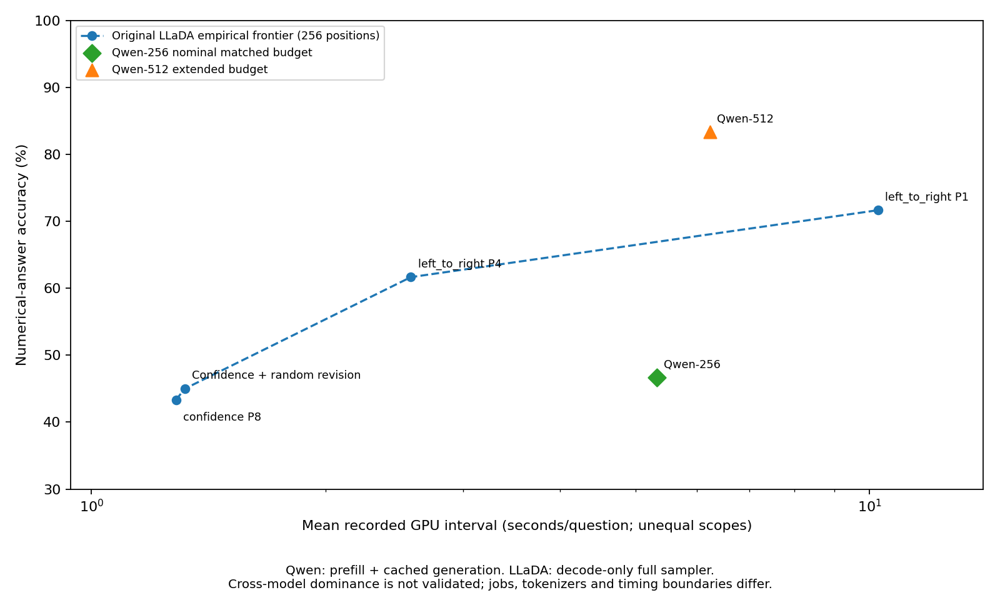
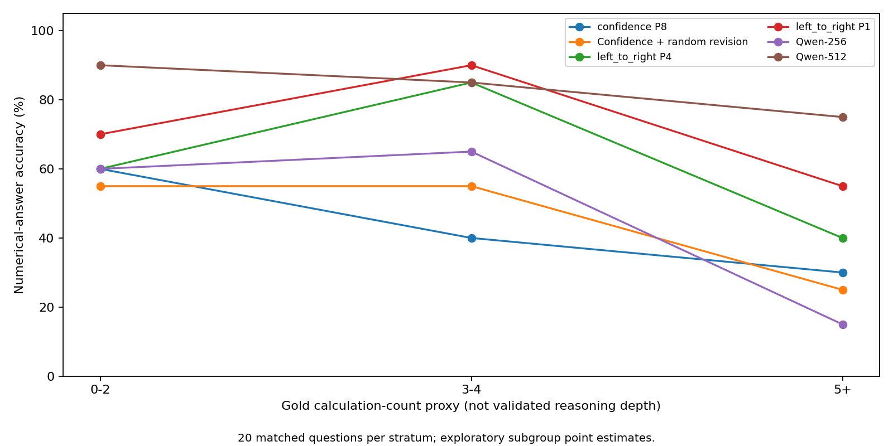
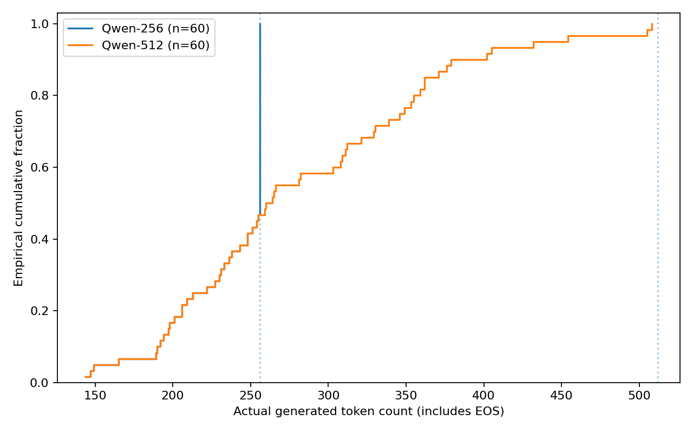

# Phase 8: matched autoregressive baseline and generation-budget sensitivity

## Scope and experimental methodology

This is an exploratory matched benchmark of numerical-answer accuracy and recorded
latency, not a controlled architecture comparison. Two completed Qwen2.5-7B-Instruct
runs use exactly the original 60 Phase 2 GSM8K test question IDs, wording, strata and
instruction suffix. There are 20 questions each in gold calculation-count strata
0–2, 3–4 and 5+; these are proxies, not validated reasoning depth. The subset excludes
all 150 Phase 1 IDs and is deliberately balanced, not a random estimate of the full
test-set distribution. No prompt tuning or baseline reruns were performed.

Model/tokenizer: `Qwen/Qwen2.5-7B-Instruct` at
`a09a35458c702b33eeacc393d103063234e8bc28`.
LLaDA: `GSAI-ML/LLaDA-8B-Instruct` at
`852152c60bdfed4632635bfcf3e83408ad3f65bf`.
Dataset: `openai/gsm8k`, main/test, revision
`740312add88f781978c0658806c59bc2815b9866`.
Selection seed is 20261014; inference seed is 42. Qwen uses its native chat template,
greedy `do_sample=False`, KV cache, batch size one, BF16, SDPA, and EOS-aware stopping.
Its only changed experimental setting is the maximum new-token budget, 256 versus
512; output paths differ for isolation. The exact suffix is:

> Solve this problem step by step. End with '#### <final numerical answer>'.

The 256 comparison is **matched in nominal generated positions**, not necessarily
in compute, tokenization, actual output length, prompt token counts, training,
parameter count, or architecture. LLaDA always fills 256 positions; Qwen may stop
at EOS. Each model uses its own tokenizer/chat template. Numerical extraction and
exact rational comparison use the unchanged shared evaluator: a last `####` marker
takes priority; malformed markers are not rescued by an earlier number, and other
fallbacks are retained. Numerical correctness does not establish faithful reasoning.

## Original LLaDA frontier and Qwen results

The four LLaDA configurations below are the original empirical Phase 7 frontier;
its data, frontier membership and report are unchanged. Qwen-256 is the nominal
matched-budget comparison; Qwen-512 is a separate **extended-budget sensitivity**.

| Configuration | Token budget / positions | Correct / n | Accuracy | Mean GPU seconds | Timing scope |
| --- | --- | --- | --- | --- | --- |
| confidence P8 | 256 | 26/60 | 43.3% | 1.283718 | LLaDA decode-only full sampler |
| Confidence + random revision | 256 | 27/60 | 45.0% | 1.317838 | LLaDA decode-only full sampler |
| left_to_right P4 | 256 | 37/60 | 61.7% | 2.572615 | LLaDA decode-only full sampler |
| left_to_right P1 | 256 | 43/60 | 71.7% | 10.250551 | LLaDA decode-only full sampler |
| Qwen-256 | 256 | 28/60 | 46.7% | 5.324409 | Qwen prefill + native cached decode |
| Qwen-512 | 512 | 50/60 | 83.3% | 6.234683 | Qwen prefill + native cached decode |

Qwen timings cover synchronized **prefill + native cached decode**, including
stream gaps from native generation scheduling; they exclude loading, tokenization,
and final CPU text decoding. LLaDA timings are **decode-only full sampler intervals**,
including the sampler's scheduling gaps and repeated prompt conditioning, without
an equivalent separate AR prefill. Neither interval is pure summed kernel time.
Per-forward AR prefill/decode intervals and generation wall time are retained in
[response_diagnostics.csv](response_diagnostics.csv). Jobs are separate even though
the Qwen environments report the same GPU/software. No timing repetitions or latency
confidence intervals were collected. Cross-model dominance is **not fully validated**
until timing boundaries and measurement conditions are harmonized; plotted positions
are descriptive observations, not architecture speedup estimates.



## Complexity-stratum comparisons

Each cell reports correct/20 and accuracy. Exploratory subgroup differences are
not evidence that complexity causes accuracy changes; question features and
selection effects are uncontrolled. The full-sample paired intervals below do not
supply simultaneous subgroup uncertainty.

| Configuration | 0–2 calculations | 3–4 calculations | 5+ calculations |
| --- | --- | --- | --- |
| confidence P8 | 12/20 (60.0%) | 8/20 (40.0%) | 6/20 (30.0%) |
| Confidence + random revision | 11/20 (55.0%) | 11/20 (55.0%) | 5/20 (25.0%) |
| left_to_right P4 | 12/20 (60.0%) | 17/20 (85.0%) | 8/20 (40.0%) |
| left_to_right P1 | 14/20 (70.0%) | 18/20 (90.0%) | 11/20 (55.0%) |
| Qwen-256 | 12/20 (60.0%) | 13/20 (65.0%) | 3/20 (15.0%) |
| Qwen-512 | 18/20 (90.0%) | 17/20 (85.0%) | 15/20 (75.0%) |



## Paired correctness and uncertainty

All contrasts match the same 60 question IDs. Differences are **B minus A** in
percentage points. Recoveries/regressions count A-wrong/B-correct and
A-correct/B-wrong. The canonical Phase 8 analysis uses 10,000 paired bootstrap
replicates, drawing 20 questions with replacement independently within each of the
three strata. Each contrast resets NumPy PCG64 to seed 42; intervals are linear
2.5/97.5 percentile quantiles, pointwise and conditional on this balanced subset.
Exact two-sided McNemar uses a binomial probability of 0.5 on discordant pairs;
Holm adjusts the family of nine displayed contrasts. This exploratory analysis
was specified after observing results and is not a preregistered confirmatory test.

| A | B | Recoveries / regressions | Δ pp | Bootstrap 95% CI pp | Exact p | Holm p |
| --- | --- | --- | --- | --- | --- | --- |
| confidence P8 | Qwen-256 | 12/10 | +3.33 | [-11.67, 18.33] | 0.831812 | 1 |
| Confidence + random revision | Qwen-256 | 9/8 | +1.67 | [-11.67, 15.00] | 1 | 1 |
| left_to_right P4 | Qwen-256 | 7/16 | -15.00 | [-30.00, 0.00] | 0.0931396 | 0.372559 |
| left_to_right P1 | Qwen-256 | 4/19 | -25.00 | [-38.33, -11.67] | 0.00259948 | 0.0140991 |
| confidence P8 | Qwen-512 | 25/1 | +40.00 | [26.67, 53.33] | 8.04663e-07 | 7.24196e-06 |
| Confidence + random revision | Qwen-512 | 24/1 | +38.33 | [25.00, 51.67] | 1.54972e-06 | 1.23978e-05 |
| left_to_right P4 | Qwen-512 | 15/2 | +21.67 | [10.00, 33.33] | 0.00234985 | 0.0140991 |
| left_to_right P1 | Qwen-512 | 12/5 | +11.67 | [0.00, 25.00] | 0.143463 | 0.430389 |
| Qwen-256 | Qwen-512 | 23/1 | +36.67 | [25.00, 48.33] | 2.98023e-06 | 2.08616e-05 |

Canonical intervals are a **new versioned offline analysis**: imported per-run
`paired_diffusion.csv` files used a shared RNG stream across four contrasts;
this report resets the RNG per contrast. Those historical files remain byte-for-byte
preserved and were checked by their original regeneration method. Any changed
interval endpoint is an analysis-stream difference, not changed observations.
[paired_tests.csv](paired_tests.csv) contains full precision, and
[provenance.json](provenance.json) records inputs and the exact method.

## Output length, EOS, markers and truncation

Counts below have denominator 60 for each budget. Generated token counts include
the terminating token; visible response lengths exclude it. Parser fallback here
means the evaluator's `last_number` branch, not all alternatives to `####`.

| Qwen cap | n | Mean generated tokens | EOS | Length-limited | #### present | Last-number fallback | Extraction failures |
| --- | --- | --- | --- | --- | --- | --- | --- |
| 256 | 60 | 235.13 | 28 | 32 | 34 | 26 | 5 |
| 512 | 60 | 282.88 | 60 | 0 | 60 | 0 | 1 |



All 60/60 Qwen-256 token sequences are exact prefixes of their matched
Qwen-512 sequences. There are 23/60 recoveries and 1/60
regressions at the larger cap. Among the 32/60 length-limited
256-token outputs there are 23/32 recoveries and
1/32 regressions. This supports an observable
budget/truncation association within these deterministic runs. It does not prove
that extra tokens were faithful reasoning or that every recovered answer needed
all additional text. A wrong fallback answer, malformed marker, or later numeric
revision can change evaluation without isolating arithmetic reasoning.
[budget_transitions.csv](budget_transitions.csv) permits matched inspection;
[termination_summary.csv](termination_summary.csv) separates EOS and cap-limited cases.
All summary counts and saved per-run numerical tables were rechecked against the
raw journals, using the unchanged evaluator. No responses were regraded by a model.

## Confirmed findings versus mechanistic hypotheses

**Confirmed in this subset:** the two reported accuracies and recorded mean
latencies; exact question/model/template matching; the disappearance of cap-limited
outputs at 512; observed correctness transitions; and prefix consistency. Qwen-512
is more accurate here than each original LLaDA frontier point, while using a larger
nominal budget. Qwen-256 is less accurate than LTR P4/P1 on this sample. Sampling
uncertainty and paired significance are shown above rather than inferred from ranks.

**Mechanistic hypotheses, not established conclusions:** additional budget may
allow completing an answer format, extending useful computation, or revising an
earlier candidate. The records do not distinguish these mechanisms automatically.
Different training, model size, tokenizer, chat template, stopping rules and runtime
can contribute to cross-model differences. The diffusion architecture itself is
not shown to cause the observed accuracy or latency differences.

## Statistical interpretation

The larger Qwen budget improves accuracy by 36.67 percentage points over Qwen-256
(23 recoveries and 1 regression). In contrast, Qwen-512 versus LTR P1 has an
observed 11.67-point advantage with 12 recoveries and 5 regressions, but its
exact McNemar p-value is 0.143463 and its pointwise bootstrap interval
is [0.00, 25.00] percentage points. This is not a confirmed population-level advantage over LTR P1. Qwen-256
versus LTR P4 likewise remains uncertain under the exact test. A boundary bootstrap
interval and an exact discordance test can disagree; neither should be selected
post hoc to imply significance.

## Future research directions

1. Analyze reasoning-budget utilization offline: first numerical candidate, first
   valid final marker, answer stability across prefixes, tokens after an answer,
   and human-audited useful computation versus repetition/format completion.
   Report prefix-extraction sensitivity separately from reasoning quality.
2. If later authorized, harmonize prefill/decode and end-to-end timing scopes,
   warmup/repetition, stopping conventions and hardware conditions before drawing
   cross-model latency or dominance conclusions.
3. Evaluate a prespecified broader question sample and budget sweep, with manual
   annotations to distinguish answer-format completion from verified arithmetic
   corrections. This report launches no new experiment or Phase 9.

## Reproducibility, integrity and publication limits

The completed HPC artifacts were already downloaded into separate local Qwen
output directories. This analysis imports hash-verified copies into
`outputs/phase8/imported/qwen_256/` and `outputs/phase8/imported/qwen_512/`,
without replacing original files. Imports reject differing existing bytes;
analysis never resumes inference, repairs journals, or writes to raw inputs.
Every run has 60 distinct completed evaluations with matching starts, no duplicates
or pending evaluations, valid manifest hashes, exact selected IDs, and consistent
saved extraction, stopping, forward counts and timing metadata. Original LLaDA
frontier rows were independently matched to completed Phase 2, 5 and 6 journals.
Input hashes, import receipts, inference-source hashes and analysis-source hashes
are in [provenance.json](provenance.json); checks are in
[integrity_checks.csv](integrity_checks.csv). Saved numerical tables were regenerated
in a temporary directory and compared without overwriting historical tables.

From a clone with analysis dependencies installed and the excluded original
selection, model pin and raw artifacts restored to their documented locations:

```bash
python -m dllm_unmasking.finalize_phase8 --diffusion-root "$DIFFUSION_RESULTS_ROOT"
```

`DIFFUSION_RESULTS_ROOT` must contain downloaded `phase2/`, `phase5/`, `phase6/`
directories. Optional `--qwen256` and `--qwen512` specify already-downloaded local
source directories. Defaults are `outputs/phase8/qwen/run` and
`outputs/phase8/qwen_512/run`. `--output-dir results/phase8_recheck` regenerates a
separate verification copy. No network, model weights, Transformers runtime or GPU
is needed. Public-only verification is:

```bash
python -m dllm_unmasking.finalize_phase8 --verify-public
```

Public per-question tables allow independent recomputation of the
statistics without full responses; raw verification additionally requires excluded
journals and the exact Phase 2 selection. [The run guide](../../experiments/phase8/README.md)
and [512 guide](../../experiments/phase8/QWEN_512.md) document original generation.

Qwen runtime: Python 3.11.17, Torch 2.11.0+cu128,
Transformers 4.45.2, CUDA 12.8;
GPU NVIDIA RTX PRO 6000 Blackwell Server Edition. Offline analysis versions and hashes are recorded
separately in provenance. Historical sources differ from current analysis wrappers;
their exact recorded bytes were located in the current checkout or local Git
history and verified by SHA256. In particular, native generation defaults for
sampling and repetition penalties are explicitly overridden by the audited
runner: greedy decoding, repetition penalty 1.0, and no n-gram repetition ban. Raw job stdout and
scheduler accounting are not part of these result directories, so independent
scheduler-level timing validation is unavailable. Native tokenizer bytes and
weights are intentionally not redistributed. No missing required result artifact
or observed aggregate discrepancy was found. Raw journals, environments and full
responses remain ignored private artifacts. Public outputs contain only compact
metrics, question IDs, sanitized reproducibility metadata and figures.


## Supplementary Phase 8.5 analysis

[Phase 8.5 — Reasoning Budget Utilization Analysis](../phase8_5/PHASE8_5_REPORT.md)
studies answer placement, output length, parser effects and the existing Qwen
continuations. It adds no inference experiment and does not change Phase 8 results.
Phase 9 is reserved for a future Qwen-256 concise-reasoning intervention.
