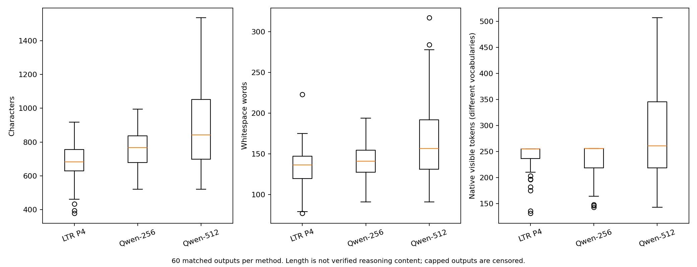
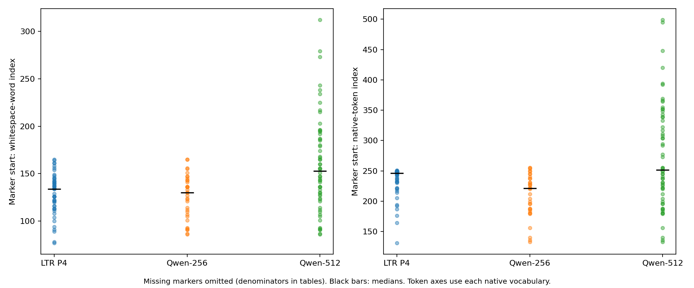
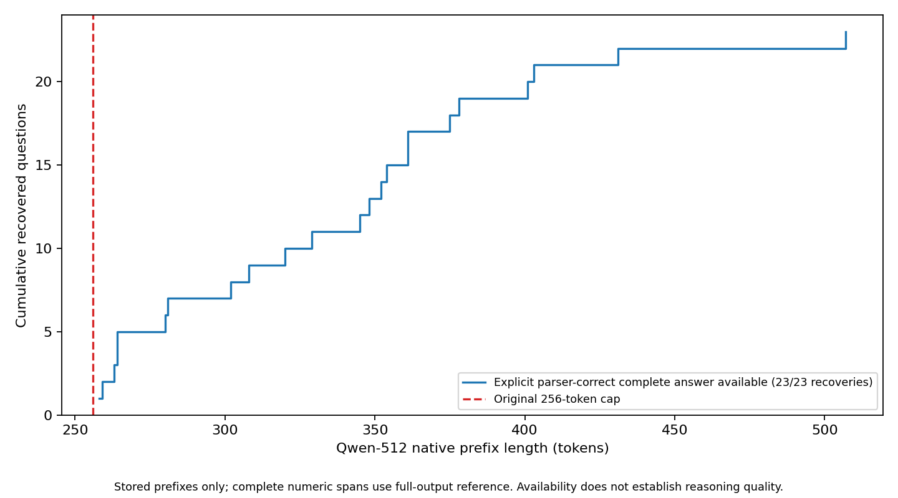

# Phase 8.5 — Reasoning Budget Utilization Analysis

## Supplementary Phase 8 analysis: question and design

Why does LLaDA LTR P4 attain 37/60 numerical-answer correctness at 256 generated
positions while Qwen reaches 28/60 at cap 256 and 50/60 at cap 512? Phase 8.5 is a supplementary analysis of Phase 8, not a separate inference experiment.
Phase 9 is reserved for a future Qwen-256 concise-reasoning intervention. This is an
**observational analysis of existing outputs**, not a GPU experiment or causal
architecture test. It audits all 60 matched questions in three outputs (180 total).
The exact question IDs, gold texts/labels, fixed instruction suffix, selection hash,
model revisions, numerical evaluator and raw artifact hashes match the immutable
[Phase 8 benchmark](../phase8/PHASE8_REPORT.md). Phase 2's LTR P4 journal and
manifest match the Phase 8 recorded hashes; both Qwen imports match every recorded
imported-file hash. Duplicate, incomplete, or mismatched inputs fail closed.

Model revisions: LLaDA `852152c60bdfed4632635bfcf3e83408ad3f65bf`; Qwen
`a09a35458c702b33eeacc393d103063234e8bc28`. Dataset revision:
`740312add88f781978c0658806c59bc2815b9866`. Each gold calculation-count stratum
(0–2, 3–4, 5+) has 20 questions; these strata are proxies, not reasoning depth.
The nominal 256 budgets differ in tokenization, compute, stopping and architecture.
LLaDA always commits 256 positions in 64 four-position steps; Qwen uses native
cached greedy generation and stops at EOS or its cap. Latency is not remeasured:
Qwen prefill+decode and LLaDA decode-only intervals remain unequal scopes.

## Measurements and definitions

Character offsets count Python Unicode code points. Words are whitespace-delimited
`\S+` spans, not linguistic word segmentation. Starts are **zero-based**, ends are
**exclusive**; an answer native end of 270 means its covering output tokens occupy
positions before 270. Native positions refer to output order, not forward-pass cost
or verified reasoning steps. LLaDA commits four positions together, so availability
at an intermediate token index is a prefix diagnostic, not an actual one-token step.
Generated counts include special/EOS tokens; visible native counts end before the
first EOS. Both decoders reproduce all 180 raw and visible responses exactly.
Exact offset mapping requires strict UTF-8; no approximate offsets are substituted.

The final marker is the last literal `####`. The final numerical answer column is
**the unchanged parser's selected numerical span**, not an independently annotated
intended answer. Missing markers and extraction failures remain missing, not zero.
Full-output numerical matches are used to identify complete numeric spans: a prefix
`1` inside a later `150` does not count as a complete correct answer for gold 1.
This hindsight rule is an offline diagnostic, not a proposed stopping policy.
First parser-correct prefixes, first explicit-cue parser-correct complete numbers,
and suffix-stable correctness are separate measurements. Gold values appearing
in a given quantity or intermediate calculation do not establish a final answer.

Estimated reasoning-step measures are **text-structure proxies**: nonempty lines,
numbered step lines, sentence-like units, and lines containing arithmetic symbols.
Markdown, copied givens, repetitions and formatting affect them; they do not measure
validated operations or reasoning quality. No arithmetic/reasoning-error label is
automatically assigned to a wrong numeric answer.

## Length and answer placement

| Output | Correct/n | Mean chars | Mean words | Mean visible native tokens | Mean nonempty lines |
| --- | --- | --- | --- | --- | --- |
| LLaDA LTR P4 | 37/60 | 686.5 | 133.5 | 240.4 | 16.4 |
| Qwen-256 | 28/60 | 757.0 | 139.2 | 234.7 | 15.1 |
| Qwen-512 | 50/60 | 884.5 | 164.0 | 281.9 | 18.2 |

Tokenizer-independent character/word counts are separated from native-token counts.
Capped Qwen-256 texts are censored solution trajectories, not completed solutions
whose shortness proves efficiency. Numerical correctness does not prove faithful
reasoning. Correct-only comparisons are selected cohorts and can introduce bias.

| Output | Marker n/60 | Mean marker char start | Mean marker word start | Mean marker native start | Selected numeric-span n/60 | Mean answer char end | Mean answer word end | Mean answer native end |
| --- | --- | --- | --- | --- | --- | --- | --- | --- |
| LLaDA LTR P4 | 51 | 663.6 | 129.2 | 233.3 | 60 | 673.5 | 130.0 | 235.3 |
| Qwen-256 | 34 | 681.5 | 125.9 | 209.7 | 55 | 736.2 | 136.0 | 229.9 |
| Qwen-512 | 60 | 858.2 | 159.7 | 273.6 | 59 | 882.6 | 163.6 | 281.4 |

All placement means are conditional on the indicated available observations.
For missing markers, the parser-selected fallback number may be an intermediate
quantity, not an intended final answer. Full distributions, denominators, correctness
strata and native/character/word positions are in [per_question.csv](per_question.csv)
and [summary.csv](summary.csv).





## All Qwen-256 errors: overlapping observable flags

There are 32/60 Qwen-256 incorrect outputs. These flags deliberately overlap;
a cap-limited output may have no marker, contain a wrong fallback number, and fail
extraction simultaneously. A cap flag is observed stopping, **not proof that the
text is semantically unfinished**. Boundary-number flags likewise identify possible
incompletion, not confirmed corrupted numbers. An explicit wrong number describes
the selected answer, not a verified arithmetic error.

| Observable flag | Count | Incorrect-output denominator |
| --- | --- | --- |
| Wrong and cap-limited (unfinished status not guaranteed) | 31 | 32 |
| Wrong and missing #### | 25 | 32 |
| Wrong explicit-marker/box/phrase selected number | 2 | 32 |
| Wrong #### selected number | 2 | 32 |
| Extraction failure | 5 | 32 |
| No parseable explicit numerical answer; role ambiguous | 30 | 32 |
| Gold-valued numerical mention elsewhere | 10 | 32 |
| Explicit gold-valued assertion elsewhere | 0 | 32 |
| Selected numeric span touches capped boundary (possible incomplete number) | 7 | 32 |

Qwen-256 stopping status is strongly associated with numerical correctness in
this sample. EOS versus cap status is not randomized; their conditional accuracies
cannot establish a causal effect of truncation.

| Qwen-256 termination | n | Correct | #### present | Extraction failures |
| --- | --- | --- | --- | --- |
| eos_observed | 28 | 27 | 28 | 0 |
| no_eos | 32 | 1 | 6 | 5 |

[termination.csv](termination.csv) also reports all three methods. For LLaDA,
no-EOS does not mean early stopping: it still filled all 256 positions; its first
EOS only defines the decoded evaluation prefix.

[qwen256_error_flags.csv](qwen256_error_flags.csv) enumerates every question,
including the correct controls; [error_summary.csv](error_summary.csv) contains
all flag counts and denominators. Ambiguous answer-role cases require human review.
Gold-valued mentions elsewhere are **not automatically parser mistakes**: they can
be given or intermediate values. Human parser mistakes require a clearly intended
answer and evidence the extractor mishandled it.

## Budget continuation: 23 recoveries and one regression

Both the saved token-ID and visible-character prefix relations hold exactly on
60/60 questions. Among the 23 recoveries, an explicit-cue complete
parser-correct answer is first available in 23/23;
23/23 first occur beyond token 256. For the available cases,
the first native prefix lengths range from 258
to 507, median 345.
In 8/23 recovered outputs, the gold value already
appears somewhere in Qwen-256, but none has a complete explicit parser-correct
answer by the cap. An intermediate gold-valued quantity is not itself a final answer.
This gives the actual continuation budget at which the answer becomes available,
not a claim about when reasoning was completed or whether a shorter derivation exists.

Regression cases: 1/60. The corresponding earlier correct
extracted value and later incorrect value are displayed in the manual packet;
the concrete regression is examined below rather than assumed to be a fallback
coincidence or damaged correct reasoning. [budget_transitions.csv](budget_transitions.csv)
contains all recoveries/regressions, first explicit/any gold placements in three
units, first parser-correct prefixes, and suffix-stability counts.



## Matched LLaDA-correct / Qwen-256-wrong cases

There are 16/60 such questions; Qwen-512 recovers 14/16.
All 16/16 of these Qwen-256 outputs exhaust the cap.
This comparison identifies a truncation/format/budget association, not a mechanism
specific to diffusion.

| Output on these matched disagreements | n | Correct | Mean words | Mean chars | Mean visible native tokens |
| --- | --- | --- | --- | --- | --- |
| LLaDA LTR P4 | 16 | 16 | 131.5 | 668.9 | 236.2 |
| Qwen-256 | 16 | 0 | 152.0 | 832.6 | 256.0 |
| Qwen-512 | 16 | 14 | 195.7 | 1057.6 | 337.9 | Representative cases below are deterministic minimum-ID
examples from each named category; they are not prevalence estimates. The full
manual packet contains all 60 side-by-side outputs, including every one of these
16 disagreements and all recovery/regression cases.

| Selection category | Question ID | Stratum | Gold | LTR P4 extracted | Qwen256 extracted | Qwen512 extracted | Qwen512 first explicit complete parser-correct native prefix |
| --- | --- | --- | --- | --- | --- | --- | --- |
| regression | 711 | 3-4 | 6 | 48 | 6 | 4 | None |
| LTR P4 correct, Qwen recovered | 30 | 3-4 | 109 | 109 | None | 109 | 263 |
| LTR P4 correct, Qwen still wrong | 214 | 0-2 | 8 | 8 | 3 | 16 | None |
| Qwen256 explicit wrong answer | 30 | 3-4 | 109 | 109 | None | 109 | 263 |
| Qwen512 extraction failure | 157 | 5+ | 80 | 100 | 2 | None | None |

### Evidence from individual outputs

- **Question 30 (recovery, gold 109):** Qwen-256 explicitly reaches `99 + 10 = 109`
  but ends with an incomplete `#### <final` suffix. The unchanged marker-priority
  parser returns failure. Qwen-512 completes the marked numerical answer. This
  particular recovery is consistent with answer-format completion, not evidence
  that additional arithmetic was required. The extractor is applying its specified
  rule; whether to rescue an earlier answer is a separate evaluation policy.
- **Question 711 (the regression, gold 6):** the 256-prefix derives six total scoops
  and the last-number fallback selects 6. The continuation distinguishes four
  paid scoops from six including free scoops, then marks 4. The question uses
  "buy" while the reference counts total scoops. This is an observable
  benchmark-answer/interpretation shift, not an automatic arithmetic-error label
  or proof that continuation spoiled valid reasoning.
- **Question 157 (512 extraction failure, gold 80):** Qwen ends with a marker and
  literal placeholder but no marked number. Its earlier computed difference is
  280; it omits the initial 200 yards in Kelly's total that the question/reference
  includes. Rescuing the earlier number would still disagree with gold. Formatting
  failure and a substantive premise omission can coexist; 3000 − 2720 = 280 is
  locally correct arithmetic, so that equation is not labeled an arithmetic error.

These are bounded manual observations of the named outputs, not automatic labels
for the remaining cases. Full questions, gold references, numerical candidates and raw/visible responses
are deliberately kept out of public artifacts. Open
[full 60-question manual audit](../../results/phase8_5/manual_audit/comparison.html)
(generated locally, excluded from Git); `annotations.csv` has blank independent
fields for intended answer, parser mistake, arithmetic evidence, reasoning quality,
format completion and verbosity. Successful extraction is not successful reasoning.

## Does compactness explain the gap?

Below, Δ is Qwen minus LLaDA on matched question IDs. Pointwise 95% intervals use
10,000 paired within-stratum bootstrap resamples, NumPy PCG64 seed 42 reset per
contrast, linear percentile quantiles. Both-correct subsets preserve their observed
stratum sizes. These are exploratory correlated contrasts without simultaneous
coverage or multiplicity-adjusted length intervals.

| Compared Qwen run | Subset | Unit | Pairs | Mean Δ | Bootstrap 95% CI |
| --- | --- | --- | --- | --- | --- |
| Qwen-256 | all | chars | 60 | 70.50 | [26.85, 114.58] |
| Qwen-256 | both_numerically_correct | chars | 21 | -14.57 | [-77.29, 46.34] |
| Qwen-256 | all | words | 60 | 5.78 | [-1.38, 13.07] |
| Qwen-256 | both_numerically_correct | words | 21 | -5.33 | [-17.19, 6.67] |
| Qwen-512 | all | chars | 60 | 198.05 | [130.40, 268.28] |
| Qwen-512 | both_numerically_correct | chars | 35 | 141.63 | [63.54, 225.23] |
| Qwen-512 | all | words | 60 | 30.50 | [19.47, 42.10] |
| Qwen-512 | both_numerically_correct | words | 35 | 20.00 | [7.14, 33.11] |

At the matched nominal 256 budget, the Qwen-minus-LLaDA word difference is
5.78 (CI [-1.38, 13.07]);
this does not establish a uniform word-count compactness difference. Among 35 questions numerically correct for both LLaDA and Qwen-512,
Qwen uses 20.00 more whitespace words on average
(CI [7.14, 33.11]). This is a
matched descriptive compactness comparison; the both-correct filter selects an
outcome-dependent cohort. Token-count contrasts in [paired_lengths.csv](paired_lengths.csv)
remain vocabulary-dependent and must not be interpreted as equal semantic budgets.
Shorter output does not establish a more efficient correct mathematical derivation.
We cannot establish that compactness mediates or causes the accuracy gap from these
records: that would require controlled response-budget/format interventions and
independent validation of useful reasoning content.

## Correctness uncertainty

Contrasts use B minus A, with recoveries/regressions on matched questions. Bootstrap
settings match the Phase 8 versioned analysis; exact two-sided McNemar tests have a
separate **three-contrast exploratory Holm family**, so adjusted p-values differ
from Phase 8's nine-contrast family while raw counts and exact p-values agree.

| A | B | n | Recoveries | Regressions | Δ pp | 95% CI pp | Exact p | Holm p (3) |
| --- | --- | --- | --- | --- | --- | --- | --- | --- |
| LLaDA LTR P4 | Qwen-256 | 60 | 7 | 16 | -15.00 | [-30.00, 0.00] | 0.0931396 | 0.0931396 |
| LLaDA LTR P4 | Qwen-512 | 60 | 15 | 2 | 21.67 | [10.00, 33.33] | 0.00234985 | 0.00469971 |
| Qwen-256 | Qwen-512 | 60 | 23 | 1 | 36.67 | [25.00, 48.33] | 2.98023e-06 | 8.9407e-06 |

## Parser, prompt, output-format and verbosity audit

The shared numerical evaluator is unchanged; stored labels are independently
recomputed. Marker counts, fallback methods, malformed final suffixes and gold-valued
intermediate mentions are visible separately. Any alternative-parser success is a
sensitivity diagnostic, not revised benchmark accuracy. No alternative answer is
silently substituted for the original selected answer.

Qwen's native chat template and tokenizer JSON/config hashes exactly match both
archived model manifests. Recorded prompts include a model-specific default system
message and native ChatML delimiters, in addition to the identical question and
instruction suffix. LLaDA used its own native template in the historical runner;
rendered prompts/tokenized prompt IDs were not logged in Phase 2, so identical full
prompt templates cannot be asserted. A local LLaDA tokenizer asset reproduces every
saved output exactly but its **revision identity is not authenticated by a historical
tokenizer checksum**, which was not recorded. Exact response decoding validates the
observed native offsets, not the provenance of an unlogged prompt template.

More words, lines or tokens can reflect model-specific style, formatting, repeated
premises, useful computation or degeneration. This analysis does not equate any
of those with faithful reasoning or automatically annotate arithmetic mistakes.
The native tokenizer-dependent and tokenizer-independent comparisons remain separate.

## Confirmed observations, uncertainties and one targeted follow-up

Confirmed: matched identities/labels/hashes; native decoding and offsets on the
observed outputs; exact Qwen continuations; the observable error flags and answer
placements above; and descriptive paired length/correctness contrasts. The lower
Qwen-256 score is associated with answer availability after the cap in many cases.

Unresolved: faithful versus merely longer reasoning, intended answers in ambiguous
outputs, parser mistakes versus malformed output, semantic unfinishedness, the
role of native templates/training, and whether compactness explains any causal part
of the gap. Gold-assisted span matching is hindsight, not a stopping rule. No causal
claim about diffusion architecture is warranted by these three observational runs.

One narrowly targeted **future experiment**, if authorized separately: hold Qwen's
model, exact questions, template and decoding settings fixed, randomize a single
instruction requesting a concise derivation within the existing 256-token cap
versus the original instruction, and predefine marker completion, numerical accuracy
and blinded reasoning-quality annotation outcomes. This tests a response-compactness
intervention within one model; it does not isolate architecture or guarantee gains.
No such prompt change, inference run or experiment is implemented here.

## Reproduction and preservation

From the repository root, with CPU analysis dependencies and local tokenizer JSONs:

```bash
python -m dllm_unmasking.analyze_phase8_5 --phase2 "$PHASE2_RESULTS" \
  --qwen-tokenizer local_tokenizers/qwen --llada-tokenizer local_tokenizers/llada
```

Qwen inputs default to the immutable Phase 8 imports under
`outputs/phase8/imported/qwen_256/` and `outputs/phase8/imported/qwen_512/`;
`--qwen256` and `--qwen512` can explicitly select exact-hash copies. Alternative
public-output reproduction can use `--output-dir results/phase8_5_recheck`; full-text
case output stays under ignored `results/phase8_5/`. No tokenizer encoding library,
Transformers runtime, weights, network or GPU is required: the audited ByteLevel
decoder maps stored IDs to UTF-8 bytes and checks raw/visible equality before use.
Unsupported decoders, mismatched Qwen tokenizer hashes, changed journals or invalid
labels cause failure rather than estimated offsets.

[Renaming provenance](renaming_provenance.json) preserves the original analysis
provenance and pre-cleanup artifact hashes. Only labels, paths and current-source
hashes changed; scientific tables and figures retain their original bytes.

Local tokenizer files remain ignored by Git. The source inference implementations
and Phase 1–8 reports/results are unchanged; inventories verify raw inputs and earlier
reports on exit. [provenance.json](provenance.json) records hashes, tokenizer
verification bounds, analysis settings, environments and source hashes. Public
artifacts contain derived metrics and compact numerical case indexes; full responses
and human annotation forms remain ignored. All categories are observational and
may overlap. No GPU inference, model download, commit or push was performed.
