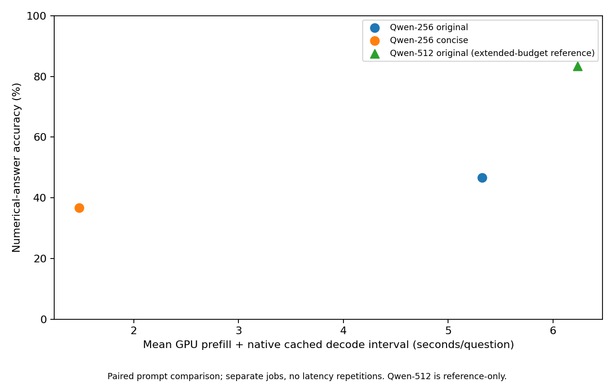
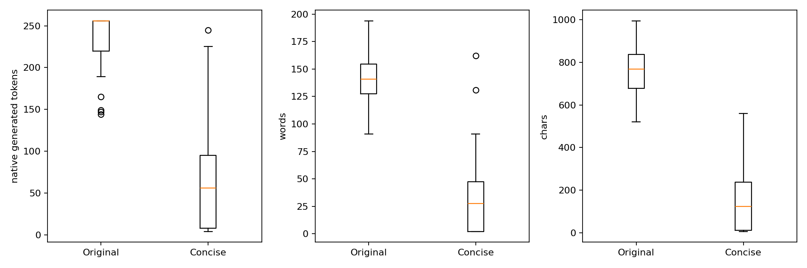
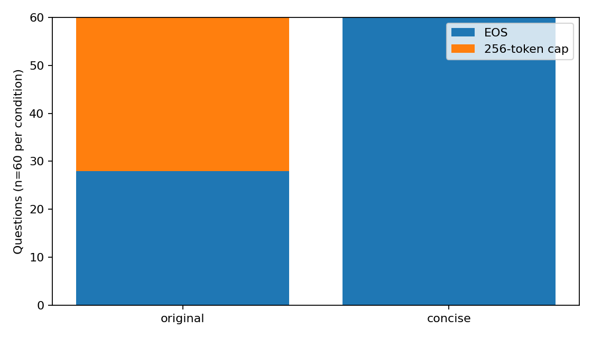

# Phase 9 — Concise Reasoning Intervention

## Abstract

A single preselected concise-reasoning instruction was tested on pinned
Qwen2.5-7B-Instruct with the same 60 GSM8K questions and a 256-token cap.
Official numerical accuracy was 22/60 (36.7%), versus 28/60 (46.7%) under the
original instruction: a −10.0 percentage-point change, with paired bootstrap
95% interval [-26.7, 6.7] and exact McNemar p=0.345.
The paired evidence does not establish either a population-level accuracy loss or
non-inferiority. Mean recorded GPU prefill+decode time fell from 5.3244 to 1.4791 s,
and every concise output ended at EOS rather than the token cap. However,
19/60 concise outputs ended with an empty final-answer placeholder, and visible
constraint/arithmetic mistakes coexist with extraction effects. Faster, shorter
outputs did not improve the preselected official accuracy metric in this subset.
This is a prompt intervention, not an architecture comparison. Blinded human
reasoning-quality review remains outstanding.

## Research question and hypotheses

Does the fixed instruction below improve numerical accuracy within Qwen at the
same nominal 256-token generation budget, by reducing budget spent on explanation?
Phase 8.5 motivated the prospective hypothesis: original Qwen-256 had 32 capped
outputs, whereas its 512-token continuation recovered many late final answers.
The directional accuracy hypothesis and brevity/termination outcomes preceded this
run. The detailed error taxonomy, parser sensitivity and stratum mechanisms below
are **posthoc exploratory analyses**, not preregistered mechanistic tests.
No wording variants were tuned on these outcomes.

## Experimental setup and integrity

Model/tokenizer: `Qwen/Qwen2.5-7B-Instruct`, revision
`a09a35458c702b33eeacc393d103063234e8bc28`; dataset `openai/gsm8k` main/test,
revision `740312add88f781978c0658806c59bc2815b9866`. Exactly the original 60 Phase 2
IDs, order, questions, gold answers and balanced 20/20/20 calculation-count strata
were reused. Selection seed 20261014; inference seed 42. Greedy decoding, KV cache,
BF16, SDPA, batch one, native chat template and EOS, at most 256 new tokens,
unchanged numerical evaluator, original GPU class and recorded software environment
were retained. The instruction occupies the same user-role position after a newline.

Original instruction:

```text
Solve this problem step by step. End with '#### <final numerical answer>'.
```

The one preselected intervention:

```text
Solve this problem using only the essential calculation steps. Be concise, avoid unnecessary explanations, and end with '#### <final numerical answer>'.
```

Rendered prompts were checked to differ only by this exact substitution. Gold
answers were used for evaluation, not generation. All 60 concise completions match
valid starts; there are no pending or duplicate evaluations. Raw manifest/config,
model/tokenizer metadata, cached-source hashes, exact native response decoding,
question execution order and saved tables were checked. All ten recorded inference
source hashes match available source bytes. Original Qwen-256/512 reference hashes
match Phase 8 receipts. LLaDA LTR P4's Phase 2 raw journal, questions, labels and
timing fields match the immutable Phase 8.5/Phase 8 provenance. No journal or
historical result was altered.

## Main results and accuracy–latency comparison

| Configuration | Correct/n | Accuracy | Mean GPU s | Median GPU s | p90 GPU s | Timing scope |
| --- | --- | --- | --- | --- | --- | --- |
| Qwen original-256 | 28/60 | 46.7% | 5.3244 | 5.7739 | 5.7928 | prefill + native cached decode |
| Qwen original-512 | 50/60 | 83.3% | 6.2347 | 5.8204 | 8.3957 | prefill + native cached decode |
| Qwen concise-256 | 22/60 | 36.7% | 1.4791 | 1.2623 | 3.3954 | prefill + native cached decode |
| LLaDA LTR P4 | 37/60 | 61.7% | 2.5726 | 2.3034 | 2.9888 | decode-only full sampler |

Concise versus original-256 reduces the recorded mean GPU interval by 72.2%
(a 3.60× ratio of means). This is an observed across-job latency comparison,
not a controlled hardware speedup. Qwen intervals include synchronized prefill plus
native cached decode and stream scheduling gaps; they exclude loading, tokenization
and final CPU text decoding. LLaDA intervals are decode-only full sampler intervals,
including repeated prompt conditioning, without a separately equivalent AR prefill.
Same GPU class/software does not eliminate scheduling or thermal variation. No
latency repetitions were collected. Cross-model dominance is not validated by
these unequal timing scopes. Original Qwen-512 and LLaDA are references, not reruns
or additional intervention arms.



## Paired correctness analysis

B is concise-256 in every row; Δ is B minus A. Counts match question IDs,
not independent strategy observations. Pointwise 95% bootstrap intervals use
10,000 paired within-stratum samples, 20 questions per stratum, NumPy PCG64 seed
42 reset per contrast, linear percentile quantiles. Exact two-sided McNemar uses
the binomial discordance test. There is one primary comparison; the two secondary
comparisons use a separate Holm family and do not change the primary p-value.

| A | Role | Both correct | Both incorrect | A correct → concise wrong | A wrong → concise correct | Δ pp | 95% CI pp | Exact p | Secondary Holm p |
| --- | --- | --- | --- | --- | --- | --- | --- | --- | --- |
| Qwen original-256 | primary | 11 | 21 | 17 | 11 | -10.00 | [-26.67, 6.67] | 0.344928 | — |
| Qwen original-512 | exploratory_secondary | 20 | 8 | 30 | 2 | -46.67 | [-60.00, -31.67] | 2.46335e-07 | 4.9267e-07 |
| LLaDA LTR P4 | exploratory_secondary | 14 | 15 | 23 | 8 | -25.00 | [-41.67, -8.33] | 0.0106738 | 0.0106738 |

The primary has 11 both-correct, 21
both-incorrect, 17 regressions and 11 recoveries.
A non-significant exact test is not evidence of equivalent accuracy. The interval
allows practically relevant loss and improvement. [Paired tables](paired_correctness.csv)
and [per-question transitions](recoveries_regressions.csv) preserve full counts and precision.

## Output length, EOS, answer placement and latency

| Condition | n | Mean generated tokens | Mean words | Mean chars | EOS | Capped | #### present | Extraction failures | Explicit answer available n/60 | Mean first explicit answer prefix tokens |
| --- | --- | --- | --- | --- | --- | --- | --- | --- | --- | --- |
| original | 60 | 235.13 | 139.25 | 756.97 | 28 | 32 | 34 | 5 | 29 | 204.79 |
| concise | 60 | 65.47 | 32.13 | 151.42 | 60 | 0 | 60 | 19 | 43 | 62.98 |

Generated tokens decrease by 72.2%; recorded latency decreases by
72.2%. These aggregate changes track one another, but do not identify a
kernel-level speedup or a pure causal latency mechanism.

Generated-token counts include EOS; visible-token counts exclude it. Words are
whitespace-delimited and characters are Unicode code points. Native tokenizer JSON
and config hashes match the pinned historical manifests; decoded raw and visible
text match all saved responses. Answer starts are zero-based, ends exclusive.
First complete explicit-answer availability is parser-defined, excludes fallback
and partial digit matches using full-output numerical spans, and does not certify
an intended correct answer or faithful reasoning. Missing explicit answers remain
missing, not token zero. Placement means are conditional on available answers;
this selection changes across conditions. The concise availability count includes
43/60 outputs with an explicit answer at some prefix, versus 41/60 that ultimately
parse successfully: questions 158 and 603 have an earlier marked/boxed number
subsequently overridden by an empty final marker. Availability is not a guarantee
of a valid final response. Full character/word/native placements,
mean/median/p90 lengths and timings are in [summary.csv](summary.csv) and
[per_question.csv](per_question.csv). Paired EOS/marker/length/latency intervals
are [exploratory secondary outcomes](paired_outcomes.csv), not simultaneous coverage.




## Error taxonomy: evidence rather than hidden-mechanism labels

All 38 officially incorrect concise responses were inspected in an **unblinded
assistant-assisted textual audit**, separate from the blinded human review below.
Every quote is verified verbatim against its stored response. Categories overlap
and are not independent events or population prevalence estimates. They describe
visible text relative to the problem/reference, not internal model computations.
This audit is not an independent human rating or evidence that reasoning quality
is preserved. Incorrect numbers alone do not establish arithmetic errors.

| Evidence category | Count | Incorrect-case denominator |
| --- | --- | --- |
| ambiguous_internal_mechanism | 13 | 38 |
| constraint_or_unit_mismatch | 7 | 38 |
| empty_final_marker | 19 | 38 |
| explicit_false_arithmetic | 5 | 38 |
| gold_valued_result_before_empty_marker | 13 | 38 |
| missing_required_term_or_conversion | 5 | 38 |
| no_visible_derivation | 13 | 38 |
| parser_selection_effect | 2 | 38 |
| unsupported_transition_in_text | 2 | 38 |
| wrong_requested_quantity | 1 | 38 |

- **Empty marked answers:** 19 responses terminate at EOS with the literal
  `#### <final numerical answer>` and no following number. Thirteen contain a
  preceding reported result equal to gold. These are output-contract failures
  under the specified marker-priority parser, not implementation bugs in that
  parser. Short output and EOS do not guarantee a valid final-answer format.
- **Parser selection effects:** questions 521 and 811 mark a final equation/rate,
  but the first-number rule selects the left operand rather than the stated result.
  The correct result is visible; official correctness remains unchanged.
- **Arithmetic/constraint evidence:** false displayed equations are checked locally;
  omitted terms or unit conversions are compared with explicit problem constraints.
  These can coexist with a malformed marker. A locally correct calculation on a
  mistaken setup is not mislabeled an arithmetic error.
- **Unsupported or unexposed work:** the audit distinguishes explicit unsupported
  transitions from 13 wrong answer-only outputs. The latter lack a visible
  derivation, so arithmetic, omitted steps and constraint interpretations remain
  ambiguous. Concise valid reasoning need not display every trivial operation.

[text_audit.csv](text_audit.csv) covers every incorrect question with evidence,
notes and annotation origin; [error_taxonomy.csv](error_taxonomy.csv) gives counts.

### Exploratory parser sensitivity, without changing official results

A uniform diagnostic selects the **last numerical mention in the entire visible
response**, independent of gold, for both original and concise outputs. It ignores
marker priority and can accidentally select intermediate quantities; it is neither
a recommended replacement evaluator nor a corrected benchmark score. It was
examined after seeing these outputs and is explicitly posthoc.

Under this diagnostic only, original-256 matches gold on 33/60 and
concise-256 on 37/60 (instead of official 28/60 and 22/60). Its paired
Δ is 6.67 pp, CI [-8.33, 21.67],
exact p=0.523467. Thirteen concise empty-marker cases and
the two equation-selection cases account for the 15 extra diagnostic matches.
That sensitivity materially changes the descriptive comparison but does not
establish faithful solutions, validate a parser change, or overturn the prespecified
primary endpoint. Per-question values and paired counts are published separately
in [parser_sensitivity.csv](parser_sensitivity.csv) and
[parser_sensitivity_paired.csv](parser_sensitivity_paired.csv).

## Representative paired examples

These are deliberately selected explanatory cases, not a random sample of errors.
The full two-condition outputs are in the local blinded packet, with the key kept
separate. Brief quotations below belong to the unblinded evidence audit, not
blinded ratings.

| Question | Original → concise official outcome | Textual evidence and bounded interpretation |
| --- | --- | --- |
| 118 | wrong → wrong | Concise explicitly computes 4 containers, then leaves an empty final marker. Original was capped. No claim that additional arithmetic is needed. |
| 211 | correct → wrong | Concise derives `r = 4` but ends with an empty marker. This regression is sensitive to output formatting, not proof of failed algebra. |
| 521 | correct → wrong | Concise ends `#### 52 - 13 = 39`; gold is 39, but the parser selects 52. |
| 975 | correct → wrong | Concise states Jerry has 30 cherries from `60 - 30 - 20`, which is 10; final 10 differs from requested difference 20. This is explicit arithmetic evidence. |
| 157 | wrong → wrong | Concise omits Kelly's initial full-field trip and gives 280 rather than 80. `3000 - 2720 = 280` is locally valid; the setup omits a term. |
| 268 | correct → wrong | Concise gives only `#### $505` versus gold 1375. The wrong value is observable; its internal cause is not. |
| 218 | wrong → correct | Original is capped; concise shows ages 66, 24 and 45 and their mean 45, then supplies a parseable answer. Brevity itself is not treated as worse reasoning. |

## Complexity strata: exploratory crossover

| Calculation-count proxy | Original correct | Concise correct | Recoveries | Regressions | Δ pp | 95% CI pp | Exact p | Holm p (3 strata) |
| --- | --- | --- | --- | --- | --- | --- | --- | --- |
| 0-2 | 12/20 | 9/20 | 4 | 7 | -15.0 | [-45.0, 15.0] | 0.548828 | 0.548828 |
| 3-4 | 13/20 | 6/20 | 2 | 9 | -35.0 | [-65.0, -5.0] | 0.0654297 | 0.196289 |
| 5+ | 3/20 | 7/20 | 5 | 1 | 20.0 | [0.0, 45.0] | 0.21875 | 0.4375 |

The 5+ group changes from 3/20 to 7/20, while 0–2 changes from 12/20 to 9/20 and
3–4 from 13/20 to 6/20. This pattern was not an independently powered hypothesis;
no subgroup establishes a significant difference under its exact test. Original
5+ outputs were capped on 17/20 questions, versus 7/20 and 8/20 in easier strata.
Concision removes that cap exposure, offering one plausible explanation for the
hard-group recoveries. But concise empty markers occur on 8/20 hard cases, 4/20
0–2 cases and 7/20 middle cases; error types coexist. The 5+ gain is five recoveries
and one regression, not evidence that the instruction improves deep reasoning.
Calculation count is a gold-solution proxy, not validated difficulty or reasoning
depth. The middle-stratum pointwise percentile interval excludes zero, while its
exact p-value is 0.0654 (Holm 0.1963); the hard-stratum interval touches zero. These
small-sample procedures need not agree. Do not select a favorable procedure after
seeing the subgroup pattern. [budget_error_transitions.csv](budget_error_transitions.csv)
links each recovery/regression to observed cap and marker status, with evidence
labels only for the audited incorrect cases. No mediation or internal-reasoning
mechanism is identified by these records.

## Blinded reasoning-quality review

A complete 60-pair packet has anonymous case IDs, A/B condition ordering and 120
rating rows. Question order uses Python random seed 20261015 and independent A/B
allocation seed 20261016. Review criteria cover arithmetic correctness, essential
intermediate-step completeness, coherence, unsupported jumps and final-answer
correctness. Shorter solutions are not automatically penalized. Only
`results/phase9/finalization/review_packet/` should be shared with reviewers; keep
`unblinding/` separate. Condition labels, original question IDs, timing/length
summaries and automated correctness labels are absent from the review packet.
Reviewers may infer conditions from style; this is label concealment, not guaranteed
successful blinding. Reviewers should avoid the unblinded report, evidence audit,
baseline outputs and key until their ratings are locked; matching a published
example could otherwise unblind a case. There are 0/120 rows with any supplied quality rating.
**No completed independent human reasoning-quality review is supplied; global
quality preservation or degradation remains unverified.** The unblinded textual
audit above does not substitute for it. Existing forms/keys are never overwritten.

## Limitations, conclusions and future directions

Verified: exact matched artifacts and prompt substitution; 22/60 official accuracy;
11 recoveries and 17 regressions; shorter outputs, all-EOS termination and lower
recorded latency; explicit empty-marker and parser-selection effects; and bounded
textual errors. Exploratory: subgroup crossover, parser sensitivity, evidence-tag
counts, and interpretations of individual changes. Untested: latent calculation
strategies, quality preservation, and whether omitted work caused a particular
wrong answer without visible evidence. Gold-matching numerical extraction is not
proof of faithful reasoning, and omitted prose is not proof of worse reasoning.

The preselected instruction did not improve the official accuracy point estimate,
but the primary paired uncertainty is too wide to claim a general accuracy loss
or equivalent performance. The recorded latency–accuracy trade-off is substantial;
output-format failures make a simple "shorter reasoning is worse" account unsupported.
These findings concern this instruction and balanced 60-question sample, with
no attribution to diffusion architecture. Questions, baseline outcomes and Phase 8.5
findings were already known; this is not a blinded holdout benchmark. Separate
GPU jobs and no timing repetitions limit latency inference.

First complete the existing blinded review. If a further intervention is later
authorized, test a separately prespecified **format-only instruction control**
that requests a bare numeric suffix without the literal placeholder, holding the
concise instruction otherwise fixed. Keep its results exploratory relative to this
locked Phase 9 instruction; do not tune/regrade the existing run or silently change
the evaluator. No new intervention, inference or prompt variant is implemented here.

## Reproducibility and publication checks

The raw concise run remains under `outputs/phase9/qwen_concise_256/run/`; original
Qwen and LLaDA journals, manifests, environments, logs and historical reports stay
unchanged. Public CSVs contain derived values and bounded evidence quotes, not
full responses, runtime logs, private allocation/host details or review keys.
[provenance.json](provenance.json) records input/source hashes, native-tokenizer
verification, exact statistics families and the distinction between textual audit
and unperformed human review. The original runtime environment matches both Qwen
baselines; analysis versions are recorded separately.

```bash
python -m dllm_unmasking.finalize_phase9 --phase2-results "$PHASE2_RESULTS"
```

Optional `--output-dir results/phase9/recheck_public` creates an independent derived
copy. The finalizer first regenerates/compares all saved numerical tables, verifies
recorded source bytes and exact question order, and checks every text-audit quote.
It preserves existing review forms. To regenerate the complete packet independently,
use a fresh `--private-dir results/phase9/recheck_private` too; share only its
review_packet/ directory. Local tokenizer assets remain ignored. No network,
weights, inference, submission, commit, push or history rewrite is used.
